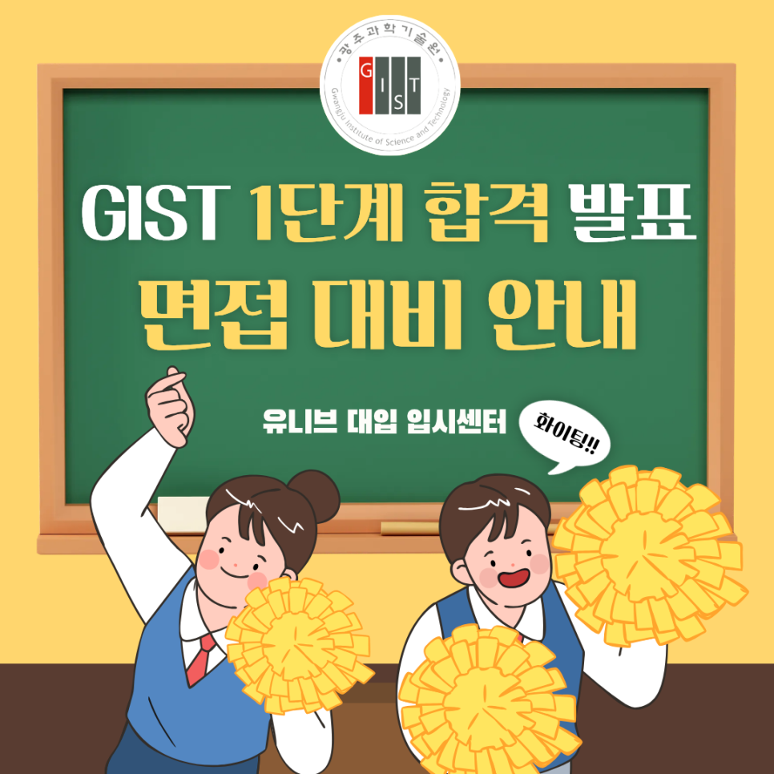

# GIST 1단계 합격자 발표, 면접까지 남은 일주일 준비법 ⏰

안녕하세요, 유니브 대입 입시센터입니다 👋

2027학년도 GIST(광주과학기술원) 수시모집  
서류전형(1단계) 합격자 발표가  
이번 주 목요일, 10월 15일 오후 6시로 예정되어 있습니다. 📢

1단계를 통과했다면 이제 남은 관문은 단 하나, 면접이에요.  
그런데 발표일부터 면접일까지 주어진 시간은  
딱 일주일뿐입니다. ⏰
​
오늘은 GIST 1단계 발표 일정부터 올해 달라진 면접 방식,  
그리고 남은 일주일을 가장 알차게 쓰는 방법까지 정리해 드릴게요. 🙌
​
## 📢 GIST 1단계 합격자 발표 & 면접 일정
​​
2027학년도 GIST 수시모집의 주요 일정은 다음과 같아요.

✔ 서류전형 합격자 발표 : 2026. 10. 15.(목) 18:00 예정  
✔ 면접전형 : 2026. 10. 22.(목) ~ 10. 23.(금)  
✔ 최초 및 예비합격자 발표 : 2026. 12. 18.(금) 18:00 예정  
✔ 최초합격자 등록 : 2026. 12. 21.(월) ~ 12. 23.(수)
​
​
면접 대상자는 전형별로 모집인원의 일정 배수 내외로 선발돼요.  
​
👉 일반전형 : 모집인원의 6배수 내외  
👉 학교장추천전형 · 고른기회전형 : 5배수 내외  
👉 특기자전형 : 4배수 내외
​
​
단순 계산으로 일반전형은 면접장에 들어간  
6명 중 1명 정도만 최종 합격하는 구조예요.  
1단계 합격은 출발선에 섰다는 의미일 뿐, 승부는 지금부터입니다.
​
​
GIST는 특별법에 의해 설립된 대학이라  
수시 6회 지원 제한에 포함되지 않아요.  
다른 대학, 다른 과학기술원과 함께 지원하는 학생이 많은 만큼  
면접 준비의 밀도가 결과를 가릅니다.
​
​
## 🔥 올해 GIST 면접, 이렇게 달라졌어요
​
​
2027학년도 GIST 입시에서 가장 눈여겨볼 변화는  
바로 면접 반영비율 확대입니다.
​
​
✔ 일반 · 학교장추천 · 고른기회전형  
작년 : 서류평가 60% + 면접평가 40%  
올해 : 서류평가 50% + 면접평가 50%
​
​

이제 면접이 서류와 똑같은 무게를 갖게 된 거예요.  
서류에서 조금 아쉬웠던 학생도 면접으로 충분히 뒤집을 수 있고,  
반대로 서류가 좋아도 면접에서 흔들리면 결과를 장담할 수 없어요.  
​
​

모집인원도 크게 늘었습니다.  
세 전형을 합쳐 총 100명이 증원됐어요.  
​

👉 일반전형 : 125명 → 195명 내외 (정원 내)  
👉 학교장추천전형 : 40명 → 60명 내외  
👉 고른기회전형 : 15명 → 25명 내외  
​
​

자기소개서도 3문항(3,100자)에서 1문항(1,800자)으로 줄었어요.  
서류에 다 담지 못한 이야기는 결국  
면접에서 직접 보여줘야 합니다. 💬
​
​
## 🔬 GIST 면접, 이렇게 진행됩니다
​
​
GIST 면접은 제출 서류를 기반으로 15분 내외 진행되는  
구술면접이에요.  
평가의 핵심은 GIST 이공계 인재적합성입니다.
​
​

### 1️⃣ 일반 · 학교장추천 · 고른기회전형
① 전공수학능력 구술면접  
→ 문제해결능력, 교과 학업 소양, 수학 · 과학적 사고력 평가  
② 내적역량 구술면접  
→ 진학의지, 의사소통능력, 리더십 등 내적역량 및 가치관 확인  
​
​

💡 여기서 잠깐!  
'전공수학능력'의 수학은 숫자를 다루는 수학(數學)이 아니라  
전공을 공부해 나가는 능력, 수학(修學)을 뜻해요.  
물론 그 안에서 수학 · 과학적 사고력도 함께 평가됩니다.
​

​
### 2️⃣ 특기자전형
① 특기역량 구술면접  
→ 특정 분야의 탁월성 또는 다양한 분야의 우수성,  
특기 내용의 검증 및 관련 분야에 대한 관심과 역량 확인  
② 내적역량 구술면접  
→ 발전가능성, 진학의지, 학업에 대한 열의, 표현력 및 인성 확인  
​
​

특기자전형은 서류평가와 면접평가를 종합해 최종 석차를 정해요.

​
​
## 🎯 15분을 합격으로 바꾸는 GIST 면접 포인트
​
​
### ✔ 첫째, 내 서류는 내가 가장 잘 설명할 수 있어야 해요  
면접 질문은 학생부와 자기소개서에서 출발합니다.  
탐구 활동의 동기와 과정, 한계와 다음 단계까지  
내 말로 막힘없이 설명할 수 있는지가 첫 번째 관문이에요.  
특기자전형이라면 수상 · 논문의 결과보다  
진행 과정과 본인의 역할을 묻는 질문에 대비해야 합니다.
​

​
### ✔ 둘째, 수학 · 과학 개념은 '왜'까지 준비하세요  
공식을 외우는 것보다, 그 개념이 왜 성립하는지  
풀이 과정을 말로 풀어낼 수 있는지가 중요해요.  
교과 개념을 소리 내어 설명하는 연습이 꼭 필요합니다.
​

​
### ✔ 셋째, 'GIST여야 하는 이유'를 분명하게
1학년 무학과로 운영되는 도전탐색과정과 1학년 말 전공선언,  
창의성 · 협동성 · 의사소통능력 · 문제해결능력의 3C1P 인재상,  
학 · 석 · 박 연계 GIFT 과정까지 GIST만의 환경을 알고  
나의 목표와 연결해 말할 수 있어야 진학의지가 설득력을 가져요.
​
​
### ✔ 넷째, 결론부터 말하는 두괄식 + 꼬리 질문 대비
15분은 생각보다 짧아요.  
핵심을 먼저 말하고 근거를 덧붙이는 습관이 있어야  
이어지는 꼬리 질문에도 흔들리지 않고 답할 수 있습니다.
​
​
## 📌 유니브 GIST 면접 대비반, 이렇게 운영됩니다
​
​
남은 일주일, 혼자 예상 질문을 뽑고 답변을 외우는 것만으로는  
실전 15분을 대비하기 어려워요.
​

​
유니브 대입 입시센터의 GIST 면접 대비반은  
담당 컨설턴트와 1:1로 진행하며  
학생의 서류 분석부터 실전 답변까지 함께 완성합니다.
​

​
✔ 수업 방식 : 담당 컨설턴트와 1:1 진행  
✔ 수업 구성 : 2시간씩 3회 또는 3시간씩 2회 중 선택  
✔ 수업 형태 : 대면 · 비대면 모두 선택 가능  
✔ 수업 비용 : 과학기술원 면접 수업 6시간 72만 원  
(추가 수업 시 1시간당 12만 원)  
​
​
## 🧩 수업에서는 이렇게 준비해요
1️⃣ 학생부 · 자기소개서 기반 예상 질문 도출  
2️⃣ 전공수학능력 대비 수학 · 과학 개념 설명 훈련  
3️⃣ 진학의지 · 내적역량 답변 구조화 (두괄식 + 꼬리 질문)  
4️⃣ 실전 모의면접과 즉시 교정  
​
​

비대면 수업도 가능해서, 서울이 아닌 지역의 학생도  
똑같이 1:1로 면접을 준비할 수 있어요. 💻

​
​
## 👨‍🏫 검증된 컨설턴트진이 직접 지도합니다
​
​
✔ 김류빈 대표원장 — 메가스터디SW입시센터 대표 컨설턴트 출신  
광주과학영재학교·고려대학교 컴퓨터학과, 학생부종합·특기자 컨설팅
​

✔ 진은재 컨설턴트 — 메가스터디SW입시센터 특기자반 강사 출신  
한국과학영재학교·KAIST 전산학부, 경시대회 문제 출제위원, 특기자·면접 컨설팅
​

✔ 박재영 컨설턴트 — 메가스터디SW입시센터 특기자반 강사 출신  
서울과학기술대학교 전자IT미디어공학과, 다수 논문 지도, 특기자 컨설팅
​

✔ 심준 컨설턴트 — 메가스터디SW입시센터 대표 강사 출신  
국민대학교 SW학과, 선린인터넷고 정보올림피아드반 강사, 학생부종합·면접 컨설팅
​

그 외에도 각 분야의 전문 컨설턴트들이 함께합니다.
​
​

최근 3년간 KAIST·서울대·고려대·연세대·중앙대 등  
주요 대학 진학을 지도해온 탄탄한 실적을 갖추고 있어요. 🏆
​

​
특히 같은 과학기술원인 KAIST 합격생을 2년 연속 지도하며  
과학기술원 면접이 무엇을 보는지 현장에서 확인해 왔습니다.
​

​
## 📅 면접 대비, 1단계 발표 직후가 골든타임입니다
​
​
GIST 면접까지 남은 시간은 단 일주일.  
발표를 확인한 그날 바로 시작해야  
6시간 수업을 여유 있게 마치고 면접장에 들어갈 수 있어요.
​

​
1:1 수업이라 컨설턴트별 일정이 빠르게 마감됩니다.  
발표 전에 미리 상담을 예약해 두면  
합격을 확인한 당일부터 바로 수업을 시작할 수 있어요. 😊
​
​

📞 전화 문의 : 02-2038-6710  
📩 카카오톡 : https://pf.kakao.com/_xbfEKX/chat

---

