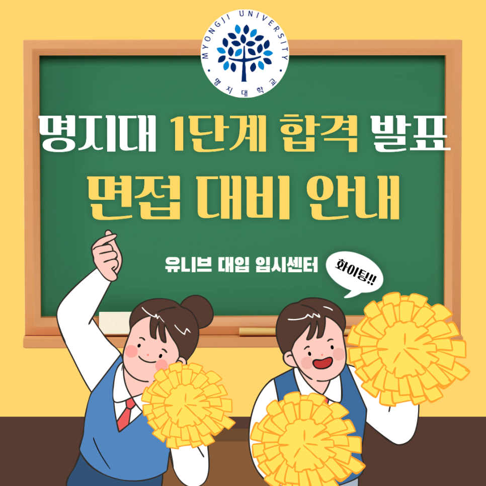
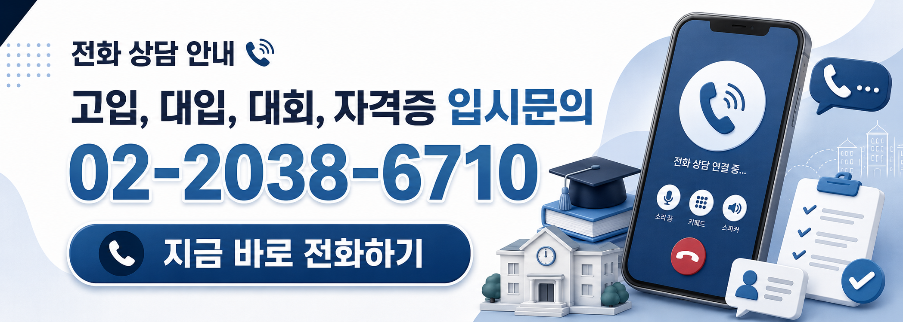

# 명지대 교과면접전형 1단계 합격자 발표, 10월 31일 면접 대비 전략 🎯

안녕하세요, 유니브 대입 입시센터입니다 👋

2027학년도 명지대학교 수시모집  
학생부교과(교과면접전형) 1단계 합격자가  
이번 주 금요일, 10월 16일 오후 3시에 발표됩니다. 📢

1단계는 교과 성적만으로 뽑지만,  
최종 합격은 면접에서 갈려요.  
면접일은 10월 31일(토), 발표 후 약 2주의 시간이 주어집니다. ⏰

오늘은 명지대 교과면접전형의 일정과 면접 방식,  
작년 입시결과로 본 면접의 영향력,  
그리고 2주를 알차게 쓰는 준비법까지 정리해 드릴게요. 🙌

## 📢 명지대 교과면접전형 1단계 발표 & 면접 일정

✔ 1단계 합격자 발표 및 고사장 발표 : 2026. 10. 16.(금) 15:00  
✔ 면접평가 : 2026. 10. 31.(토) (1단계 합격자에 한함)  
✔ 최종 합격자 발표 : 2026. 12. 9.(수) 15:00  
→ 모두 입학처 홈페이지에서 확인해요.

면접은 인문캠퍼스(서울)에서 진행돼요.  
자연캠퍼스(용인) 학과에 지원했더라도  
면접은 서울 인문캠퍼스로 가야 하니 꼭 확인하세요.

✔ 모집인원 : 총 269명  
인문캠퍼스(서울) 144명 · 자연캠퍼스(용인) 125명

올해는 자율전공학부(인문) · (자연)이 교과면접전형에서  
각 10명씩 새로 선발해요.  
전기전자공학부는 전기정보공학전공 8명, 전자공학전공 10명으로  
나누어 뽑고, 컴퓨터AI응용공학부는  
AI컴퓨터공학전공 · AI응용시스템전공으로 이름이 바뀌었어요.

## 🔥 면접 30%, 정말 결과가 바뀔까?

명지대 교과면접전형은 이렇게 선발해요.

👉 1단계 : 학생부(교과) 100%로 모집인원의 5배수 선발  
👉 2단계 : 학생부(교과) 70% + 면접 30%

면접 비중이 30%라 작아 보일 수 있지만,  
1단계를 통과한 학생들의 교과 성적은 서로 비슷해요.  
작년 법학과 최종등록자의 학생부 환산점수는  
최고 720.5점, 70% cut 715.4점으로 차이가 약 5점이었어요.  
1,000점 중 300점이 걸린 면접에서 충분히 뒤집히는 차이예요.

실제로 작년 법학과 · 반도체공학부 · 응용소프트웨어전공은  
1단계 합격자 최저 등급과 최종등록자 최저 등급이 같았어요.  
1단계를 커트라인 등급으로 통과한 학생도  
최종 등록까지 갔다는 뜻이에요.

교과 성적은 이미 정해졌어요.  
지금부터 바꿀 수 있는 건 면접 점수뿐입니다. 💪

## 🔬 명지대 교과면접, 이렇게 진행됩니다

✔ 면접 방법 : 개별면접 (면접위원 2명)  
✔ 면접 시간 : 약 5분 내외  
✔ 면접자료 : 면접 전 면접기초자료 작성 (20분)

면접기초자료는 2~3문항의 간략한 자기소개 형태예요.  
평가 점수에는 반영되지 않고 참고자료로만 활용돼요.

## 📊 평가항목과 반영비율
① 공동체역량 35% : 성실성, 공동체의식, 소통능력  
② 진로역량 35% : 진로탐색 활동과 경험  
③ 의사소통능력 30% : 논리성, 전달능력

⚠️ 면접은 블라인드로 진행돼요.  
수험번호, 성명, 출신고교가 가려지고,  
교복 등 본인을 특정할 수 있는 옷차림은 금지예요.  
어기면 불이익은 모두 지원자 본인 책임이니 꼭 주의하세요.

## 🎯 5분을 합격으로 바꾸는 명지대 면접 포인트

### ✔ 첫째, 면접기초자료는 미리 써 봐야 해요  
작년(2026학년도)에는 이런 문항이 나왔어요.

· 지원 전공에서 가장 중요한 역량과 이를 위해 고교에서 한 활동  
· 전공 졸업 10년 후의 모습과 이를 위한 준비과정  
· 전공 관련 가장 관심 있는 주제와 관련 고교 활동  
· 입학 후 교과 및 비교과 대학생활 계획

점수에는 들어가지 않지만 면접관이 참고하는 자료예요.  
20분 안에 막힘없이 쓰는 연습을 미리 해 두면  
면접 질문에도 같은 내용으로 일관되게 답할 수 있어요.

### ✔ 둘째, 진로역량은 '활동 하나'를 깊게 준비하세요
진로역량 평가요소는 진로탐색 활동과 경험이에요.  
지원 학과와 연결된 활동 하나를 골라  
동기 → 과정 → 배운 점 순서로 설명할 수 있어야 합니다.

### ✔ 셋째, 공동체역량은 구체적인 장면으로 답하세요
'성실하다', '협동을 잘한다'는 말보다  
모둠 활동에서 갈등을 조정한 경험처럼  
내가 실제로 한 행동이 보이는 사례 1~2개를 준비하세요.

### ✔ 넷째, 5분은 생각보다 짧아요
의사소통능력은 논리성과 전달능력을 봐요.  
결론부터 말하고 근거를 덧붙이는 두괄식으로,  
답변 하나를 1분 안팎으로 끝내는 연습이 필요합니다.  
블라인드 면접이니 답변 중 학교 이름이 나오지 않게도 주의하세요.

## 📌 유니브 명지대 면접 대비반, 이렇게 운영됩니다

면접 시간은 5분이지만,  
그 5분을 준비하는 데는 체계적인 연습이 필요해요.

유니브 대입 입시센터의 명지대 면접 대비반은  
담당 컨설턴트와 1:1로 진행하며  
면접기초자료 작성부터 실전 답변까지 함께 완성합니다.

✔ 수업 방식 : 담당 컨설턴트와 1:1 진행  
✔ 수업 구성 : 2시간씩 3회 또는 3시간씩 2회 중 선택  
✔ 수업 형태 : 대면 · 비대면 모두 선택 가능  
✔ 수업 비용 : 일반대학 면접 수업 6시간 60만 원  
(추가 수업 시 1시간당 10만 원)

## 🧩 수업에서는 이렇게 준비해요
1️⃣ 작년 문항으로 면접기초자료 20분 실전 작성  
2️⃣ 학생부 기반 예상 질문과 평가항목별 답변 소재 정리  
3️⃣ 두괄식 답변 구조화 + 꼬리 질문 대비  
4️⃣ 5분 실전 모의면접과 즉시 교정

💡 면접까지 약 2주가 있으니  
2시간씩 3회로 나누어 수업 사이에 스스로 연습하는 시간을 두면  
답변이 훨씬 자연스러워져요.

## 👨‍🏫 검증된 컨설턴트진이 직접 지도합니다

✔ 김류빈 대표원장 — 메가스터디SW입시센터 대표 컨설턴트 출신  
광주과학영재학교·고려대학교 컴퓨터학과, 학생부종합·특기자 컨설팅

✔ 강은솔 컨설턴트 — 메가스터디SW입시센터 대표 강사 출신  
세종대학교 SW학과, 풀스택 개발자 출신, AI·대회 컨설팅

✔ 심훈 컨설턴트 — 메가스터디SW입시센터 대표 강사 출신  
숭실대학교 컴퓨터학부, 특목고 및 대입 자소서 강의·첨삭 다수, 면접·내신 컨설팅

✔ 문준수 컨설턴트 — 메가스터디SW입시센터 특기자반 강사 출신  
한국외국어대학교 컴퓨터공학과·정치외교학과, GDG 캠퍼스 프로젝트 리드, 면접·SW인재 컨설팅

그 외에도 각 분야의 전문 컨설턴트들이 함께합니다.

최근 3년간 KAIST·서울대·고려대·연세대·중앙대 등  
주요 대학 진학을 지도해온 탄탄한 실적을 갖추고 있어요. 🏆

숭실대 · 광운대 · 단국대 · 가천대 등 서울 · 수도권 대학에서도  
2~5등급대 학생들의 합격을 함께 만들어 왔습니다.

## 📅 면접 대비, 1단계 발표 직후가 골든타임입니다

10월 16일 발표부터 10월 31일 면접까지 약 2주.  
발표를 확인한 그 주에 바로 시작해야  
6시간 수업을 마치고 충분히 연습한 뒤 면접장에 들어갈 수 있어요.

1:1 수업이라 컨설턴트별 일정이 빠르게 마감됩니다.  
발표 전에 미리 상담을 예약해 두면  
합격을 확인한 당일부터 바로 수업을 시작할 수 있어요. 😊

📞 전화 문의 : 02-2038-6710  
📩 카카오톡 : https://pf.kakao.com/_xbfEKX/chat

---

