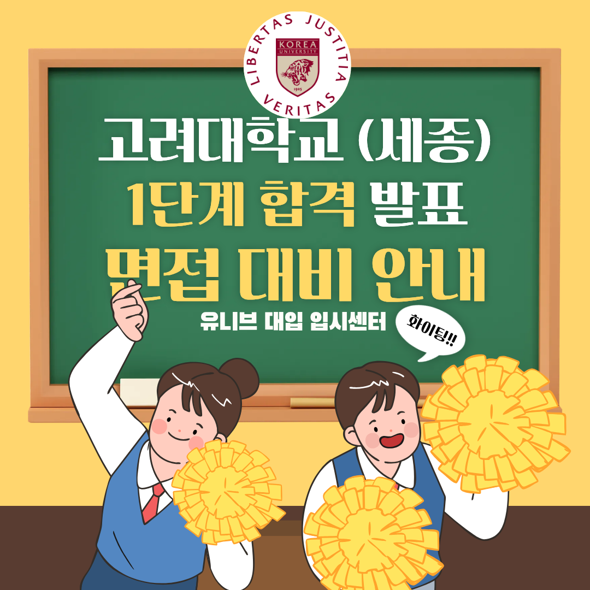

# 고려대 세종 1단계 합격자 발표, 하루 일찍 떴다! 10월 31일 면접 대비 ⏰

안녕하세요, 유니브 대입 입시센터입니다 👋

2027학년도 고려대학교 세종캠퍼스 수시모집  
미래인재 · 글로벌스포츠인재 · 체육특기자전형의 1단계 합격자가 발표되었습니다. 📢

모집요강에 안내된 발표일은 10월 23일(금)이었는데,  
하루 빠른 10월 22일(목)에 발표됐어요.  
아직 결과를 확인하지 않았다면 입학팀 홈페이지에서 바로 조회해 보세요.

미래인재 · 글로벌스포츠인재전형 면접은 10월 31일(토),  
남은 시간은 9일입니다. ⏰

오늘은 면접 일정과 선발 방식,  
기본점수가 없는 면접 30%의 진짜 의미,  
그리고 9일을 알차게 쓰는 준비법까지 정리해 드릴게요. 🙌

## 📢 고려대 세종 1단계 합격자 발표 & 면접 일정

✔ 1단계 합격자 발표 : 2026. 10. 22.(목)  
(모집요강상 예정일 10. 23.(금) 17:00보다 하루 앞당겨 발표)  
✔ 면접 : 2026. 10. 31.(토) 09:00까지 입실  
→ 대상 : 미래인재전형, 글로벌스포츠인재전형  
→ 장소 : 고려대학교 세종캠퍼스  
✔ 최종 합격자 발표 : 2026. 12. 18.(금) 17:00

👉 체육특기자전형 면접은 하루 앞선 10. 30.(금)에 진행돼요.  

세부 면접장소와 수험생 유의사항은  
모집요강상 10월 23일(금) 입학팀 홈페이지(oku.korea.ac.kr)에 공지돼요.  
면접조 편성에 따라 입실 완료 시간과 면접 시작 시간이 학생마다 다를 수  
있으니 반드시 직접 확인하세요.  

## 🧭 미래인재전형, 이렇게 선발해요

미래인재전형은 자신의 전공 분야를 이끌 창의적 사고력과  
역량을 가진 학생을 뽑는 실기/실적 전형이에요.

✔ 모집인원 : 총 19명  
→ 컴퓨터소프트웨어학과 3명  
→ 인공지능사이버보안학과 6명  
→ 문화창의학부(미디어문예창작 · 문화콘텐츠전공) 10명  

✔ 1단계 : 서류평가 100%로 모집인원의 3배수 선발  
✔ 2단계 : 1단계 성적 70% + 면접 30%  
✔ 수능최저 : 없음

서류는 학생부와 함께 활동증빙서류(최대 5개 활동 실적)를 평가해요.  
평가요소는 전공적합성, 창의적 발전성, 공동체역량입니다.

💡 미래인재전형은 2027학년도까지만 모집하고  
2028학년도에 폐지될 예정이에요. 올해가 마지막 기회입니다.  
글로벌스포츠인재전형(국제스포츠학부 20명)도  
3배수 선발, 1단계 70% + 면접 30%로 같은 방식이에요.

## 🔥 면접 30%, 기본점수가 없다는 게 무슨 뜻일까?

2단계 총점은 1,000점이에요.  
1단계 성적 700점 + 면접 300점으로 구성됩니다.

모집요강의 전형요소별 최고/최저점을 보면  
서류평가는 1,000점 ~ 0점, 면접평가는 300점 ~ 0점이에요.  
즉, 기본점수가 없어요.

기본점수가 있는 대학은 실제 점수 차이가 줄어들지만,  
고려대 세종 미래인재전형은 0점부터 300점까지 전 구간을 써요.  
모집요강에 적힌 30%가 그대로 실질 반영비율이라는 뜻이에요.

3배수 선발이라 면접장에 들어간 3명 중 1명이 합격하는 구조이고,  
동점자 처리 1순위도 면접평가 성적이에요.  
면접 점수가 합격을 직접 가른다고 봐도 됩니다.

## 🔬 고려대 세종 면접, 이렇게 진행됩니다

✔ 면접 방식 : 다대일 면접 (면접위원 여러 명 + 수험생 1명)  
✔ 면접 시간 : 수험생 1인당 10분 내외  
✔ 면접 유형 : 제출서류 기반 인 · 적성 면접

## 📊 평가 내용
제출서류를 바탕으로 아래 내용을 종합적으로 평가해요.  

① 전공에 대한 관심 및 학습계획  
② 사고력과 의사소통능력  
③ 공동체에 대한 태도

⚠️ 면접에 결시하면 선발하지 않아요.  
세종캠퍼스까지 이동 시간을 넉넉히 잡고 9시 입실에 늦지 않도록 하세요.

## 📎 활동증빙서류, 면접의 핵심 재료입니다

미래인재전형 지원자는 학과와 관련된 교내 · 외 활동 실적을  
최대 5개까지 증빙서류로 제출했어요.  
수상경력, 동아리 활동, 자격증, 봉사활동 등이 여기에 해당해요.

면접은 제출서류를 바탕으로 진행되니,  
내가 낸 5개 활동은 면접관 앞에 그대로 놓여 있다고 생각하세요.

증빙서류는 상장, 자격증, 수료증처럼  
제3자가 발급한 증명서 형식만 인정돼요.  
서류에는 결과만 적혀 있으니,  
그 활동을 왜 시작했고 내가 무엇을 했는지는 면접에서 말로 보여줘야 합니다.

✔ 활동마다 이렇게 정리해 두세요  
동기 → 나의 역할 → 과정에서 부딪힌 문제 → 해결 방법 → 배운 점

## 🎯 남은 9일, 이렇게 준비하세요

✔ D-9 ~ D-7 : 학생부와 활동증빙서류 다시 읽기  
제출한 활동 5개와 학생부의 전공 관련 활동을  
하나씩 1분 안에 설명할 수 있게 정리하세요.

✔ D-6 ~ D-4 : 전공 관심과 학습계획 준비  
지원 학과에서 무엇을 배우고 싶은지,  
내 활동이 그 공부로 어떻게 이어지는지 연결해 두세요.  
"다르게 했다면 어땠을까?" 같은 사고력 질문도 대비해야 해요.

✔ D-3 ~ D-1 : 다대일 10분 실전 모의면접  
여러 면접관 앞에서 결론부터 말하는 두괄식으로 답하고,  
꼬리 질문에 흔들리지 않도록 반복 연습하세요.

## 📌 유니브 고려대 세종 면접 대비반, 이렇게 운영됩니다

활동 실적이 아무리 좋아도  
면접에서 내 말로 설명하지 못하면 점수로 이어지지 않아요.

유니브 대입 입시센터의 고려대 세종 면접 대비반은  
담당 컨설턴트와 1:1로 진행하며  
학생부와 활동증빙서류 분석부터 실전 답변까지 함께 완성합니다.

✔ 수업 방식 : 담당 컨설턴트와 1:1 진행  
✔ 수업 구성 : 2시간씩 3회 또는 3시간씩 2회 중 선택  
✔ 수업 형태 : 대면 · 비대면 모두 선택 가능  
✔ 수업 비용 : 일반대학 면접 수업 6시간 60만 원  
(추가 수업 시 1시간당 10만 원)

💡 면접까지 9일이 있으니  
2시간씩 3회로 나누어 수업 사이에 스스로 연습하는 시간을 두면  
답변이 훨씬 자연스러워져요.

## 🧩 6시간 수업, 이렇게 채워집니다

1️⃣ 학생부와 활동증빙서류 5개 분석, 예상 질문 도출  
→ 면접관이 가장 먼저 물어볼 활동을 미리 짚어요.  
2️⃣ 전공 관심과 학습계획 답변 구조화  
→ 내 활동과 입학 후 공부를 하나의 흐름으로 연결해요.  
3️⃣ 두괄식 답변 + 꼬리 질문 · 사고력 질문 대비  
→ "왜?", "다르게 했다면?"에 흔들리지 않게 연습해요.  
4️⃣ 다대일 10분 실전 모의면접과 즉시 교정  
→ 실제 면접과 같은 형식으로 연습하고 바로 고쳐요.

외운 답변이 아니라 내 활동에서 나온 내 이야기로  
면접장에 들어갈 수 있도록 함께 준비합니다. 💪

## 👨‍🏫 검증된 컨설턴트진이 직접 지도합니다

✔ 김류빈 대표원장 — 메가스터디SW입시센터 대표 컨설턴트 출신  
광주과학영재학교·고려대학교 컴퓨터학과, 학생부종합·특기자 컨설팅

✔ 진은재 컨설턴트 — 메가스터디SW입시센터 특기자반 강사 출신  
한국과학영재학교·KAIST 전산학부, 경시대회 문제 출제위원, 특기자·면접 컨설팅

✔ 강은솔 컨설턴트 — 메가스터디SW입시센터 대표 강사 출신  
세종대학교 SW학과, 풀스택 개발자 출신, AI·대회 컨설팅

✔ 문준수 컨설턴트 — 메가스터디SW입시센터 특기자반 강사 출신  
한국외국어대학교 컴퓨터공학과·정치외교학과, GDG 캠퍼스 프로젝트 리드, 면접·SW인재 컨설팅

그 외에도 SW·AI 각 분야의 전문 컨설턴트들이 함께합니다.

최근 3년간 KAIST·서울대·고려대·연세대·중앙대 등  
주요 대학 진학을 지도해온 탄탄한 실적을 갖추고 있어요. 🏆

고려대학교 컴퓨터학과 출신 김류빈 대표원장이 직접 이끄는 팀이  
대회 · 자격증 실적을 면접 답변으로 바꾸는 방법까지 함께 짚어 드립니다.

## 🤝 Uway 인증 파트너, 믿고 맡길 수 있는 곳

유니브 대입 입시센터는 대입 입시기관 Uway의  
대치동 유일 인증 파트너 학원이에요.

입시 전문성과 체계적인 학생 관리 서비스를 바탕으로  
학생과 학부모가 믿고 선택할 수 있는 교육 환경을 만들어 가고 있습니다. 😊

## 📅 면접까지 D-9, 지금 바로 신청하세요

면접까지 남은 시간은 9일.  
1:1 수업이라 컨설턴트별 일정이 빠르게 마감됩니다.  
일찍 시작할수록 수업 사이에 연습할 시간이 넉넉해져요.

✅ 수업 신청은 이렇게 간단해요  
1️⃣ 아래 신청 링크에서 이름과 전화번호 입력  
2️⃣ 바로 결제  
3️⃣ 결제 완료 후 담당 컨설턴트 선생님이 직접 전화

복잡한 상담 절차 없이 이름과 전화번호만 입력하면 신청 끝이에요.  
👉 수업 바로 신청하기 : [[ 여기를 클릭하세요 ]](https://univconsulting.kr/pay?p=NoIkAM2KHjAEguXYiBNQIwC5FQBSAOawJB1ioDkHBQiYEoQAaANgAYaaBdIA)

💬 카카오톡으로 신청하고 싶다면?  
원하는 날짜와 수업 구성(2시간×3회 / 3시간×2회)을 정해  
카카오톡으로 "고려대 세종 면접 대비반 ㅇ월 ㅇ일 ㅇ시간×ㅇ회 신청합니다"  
로 신청 주세요. 😊  

📞 전화 문의 : 02-2038-6710  
📩 카카오톡 : https://pf.kakao.com/_xbfEKX/chat

---

