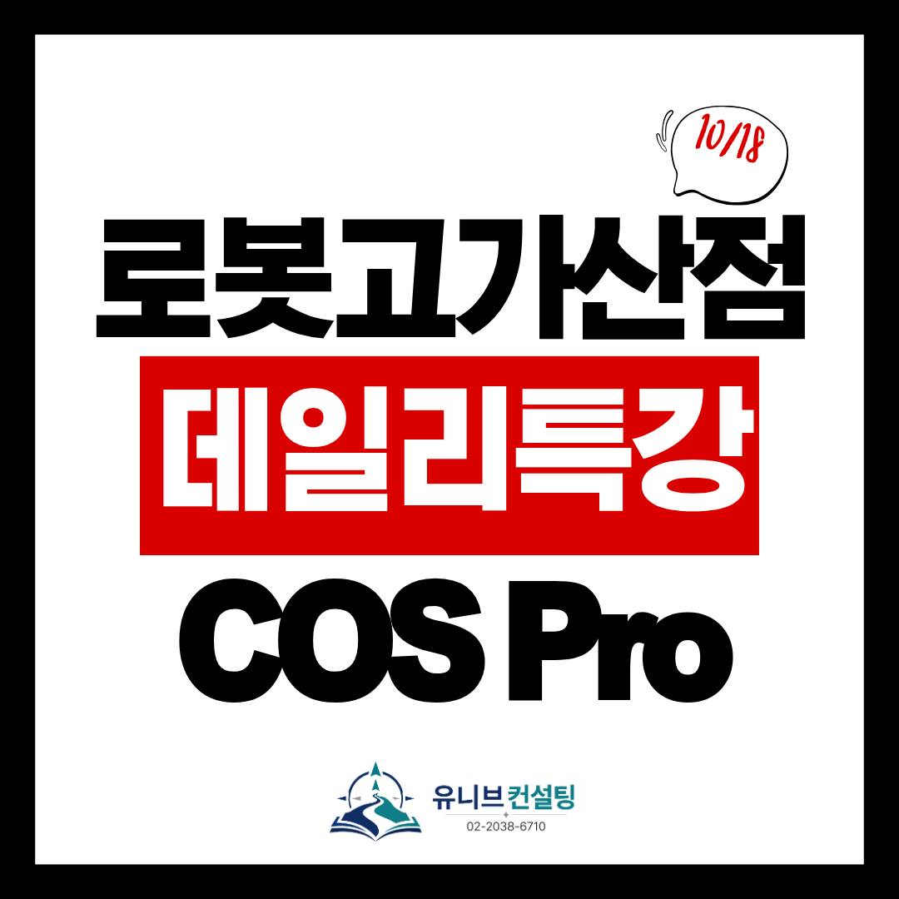

안녕하세요, 유니브 고입 입시센터입니다 👋

로봇고 진학을 준비하는 중3 학생·학부모님께  
꼭 필요한 소식을 들고 왔어요! 🎉

로봇고 입시에서 가산점 6점을 받을 수 있는  
COS Pro 3급 자격증을 단 하루 만에 끝내는  
'데일리 완성 특강'을 오픈합니다. 🚀

## 🤖 로봇고 입시, 왜 COS Pro 3급일까요?

로봇고 입시에서는 COS Pro 3급 자격증으로  
가산점 6점을 받을 수 있어요.
​
내신 성적은 지금 와서 크게 바꾸기 어렵지만,  
자격증 가산점은 짧은 시간 집중하면  
확실하게 챙길 수 있는 점수입니다. 💪

합격선 근처에서는 작은 점수 차이로도  
결과가 달라지는 경우가 많아요.  
6점은 결코 작은 점수가 아닙니다.

## 📌 COS Pro 3급, 어떤 자격증인가요?

COS Pro는 YBM이 주관하는  
코딩활용능력전문가 자격시험이에요.

실제로 코드를 작성하는 실기 시험이고,  
3급은 프로그래밍 입문 단계에 해당합니다.

IT특성화고·마이스터고 입시에서 활용되고,  
자기소개서와 포트폴리오에서도  
코딩 역량을 보여주는 핵심 어필 요소가 돼요. ✨

## ⏰ 단 하루, 수업부터 시험까지 한 번에!

✔ 일시 : 10월 18일(일) 10:00~18:00  
✔ 장소 : 유니브 고입 입시센터  
✔ 시험 : 수업 직후 18시, 학원에서 바로 응시

아침 10시부터 출제 유형 분석과 기출 풀이로  
시험에 나오는 것만 집중적으로 훈련하고,  
수업이 끝나는 18시에 학원에서 바로 시험을 봅니다.

따로 시험장을 찾아갈 필요 없이,  
배운 감각 그대로 실전에 들어가니  
합격 가능성은 높이고 부담은 줄였어요. 😊

## 💯 자격증 미취득 시, 수강료 전액 환불

그만큼 자신 있습니다.

특강을 듣고도 자격증을 취득하지 못하면  
수강료를 전액 환불해 드려요.  
※ 환불 대상은 수강료이며, 응시료는 별도입니다.

코딩이 처음인 학생도 걱정하지 마세요.  
하루 동안 컨설턴트가 개별 지도로  
끝까지 함께합니다. 🎯

## 👨‍🏫 검증된 컨설턴트진이 직접 지도합니다

✔ 김류빈 대표원장 — 메가스터디SW입시센터 대표 컨설턴트 출신  
광주과학영재학교·고려대 컴퓨터학과, 고입·대입 전략 컨설팅

✔ 심준 컨설턴트 — 메가스터디SW입시센터 대표 강사 출신  
IT특성화고·국민대 SW학과, 로봇 프로그래밍·임베디드·피지컬AI

✔ 박재영 컨설턴트 — 메가스터디SW입시센터 특기자반 강사 출신  
C++·자료구조·알고리즘, 다수 논문 지도

✔ 성우용 컨설턴트 — 전자계열 특성화고 출신  
전기전자·반도체·자격증 담당, 마이스터고 면접 전문

그 외에도 SW·AI 각 분야의 전문 컨설턴트들이 함께합니다.

서울로봇고·선린인터넷고·단국대부속소프트웨어고 등 고입 합격생을 직접 지도해 왔고,  
최근 3년간 KAIST·서울대·고려대·연세대·중앙대 등  
주요 대학 진학을 지도해온 탄탄한 실적을 갖추고 있어요. 🏆

## 📅 수업 신청은 10월 15일(목)까지!

COS Pro 시험 접수를 함께 진행해야 해서  
수업 신청은 10월 15일(목)까지 받아요.

✔ 특강명 : 로봇고 가산점 COS Pro 3급 데일리 완성 특강  
✔ 일시 : 10월 18일(일) 10:00~18:00 (18:00 시험)  
✔ 수강료 : 9만원 (응시료 별도)  
✔ 신청 마감 : 10월 15일(목)  
✔ 환불 : 자격증 미취득 시 수강료 전액 환불

📝 신청 방법은 정말 간단해요!  
아래 링크에서 이름과 연락처만 입력하고 신청하면  
담당 컨설턴트 선생님이 직접 연락드립니다. 😊

👉 신청하기 : https://bit.ly/robotcospro3

가산점 6점, 하루면 충분합니다.  
마감 전에 꼭 신청하세요! 🎯

📞 전화 문의 : 02-2038-6710  
📩 카카오톡 : https://pf.kakao.com/_xbfEKX/chat

---

