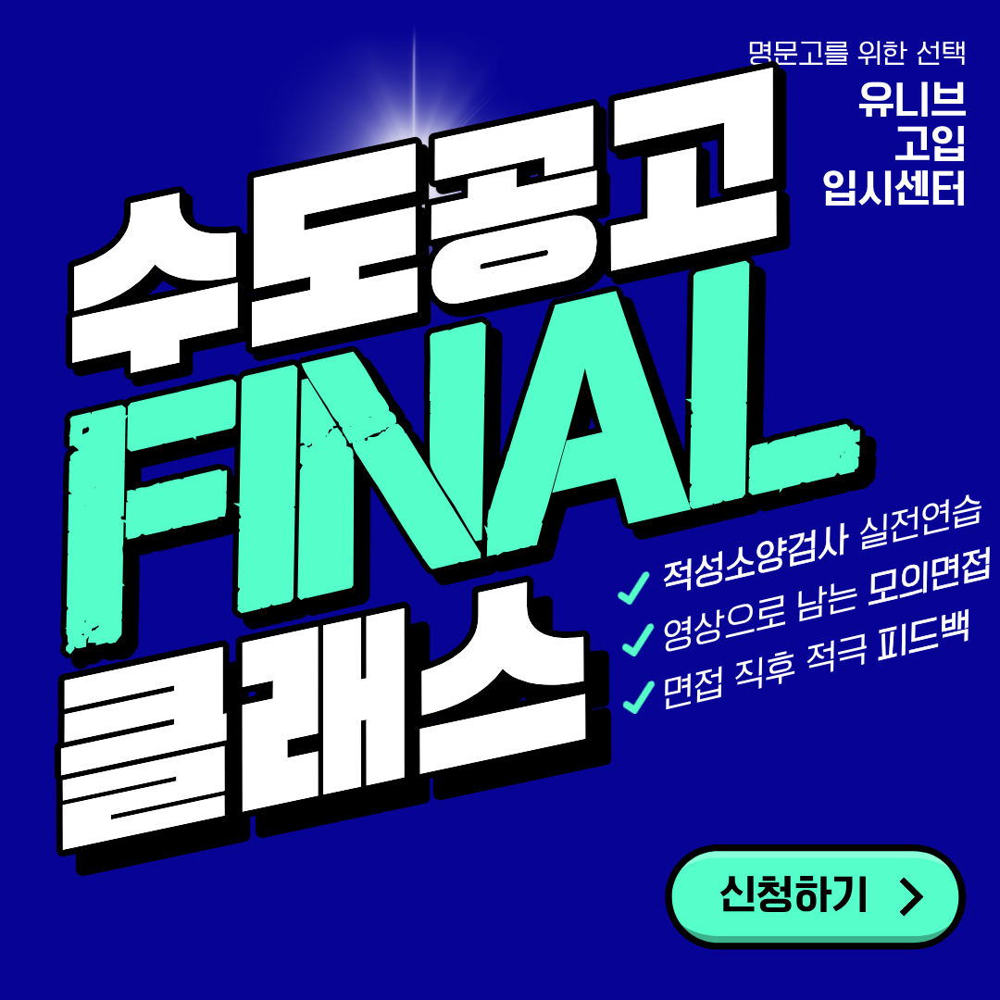

안녕하세요, 유니브 고입 입시센터입니다 👋

수도전기공고 입학 전형일이 이제 D-8로 다가왔어요.  
(10월 29일 목요일)

원서 접수를 마치고 나면 남은 건 딱 두 가지,  
마이스터 적성·소양 검사와 심층면접이에요.

그래서 준비했습니다.  
수도공고 지원생만을 위한 파이널 클래스! 🔥

## 📅 2027학년도 수도전기공고 입학 전형 일정

✔ 원서 접수 : 10.12(월) ~ 10.22(목) 17:00  
✔ 수험표 출력 : 10.26(월) 13:00부터  
✔ 입학 전형(학교 방문) : 10.29(목)  
✔ 합격자 발표 : 11.04(수) 10:00

아직 원서를 내지 않았다면 내일(10/22) 17시가 마감이에요.  
우편 제출은 10.22 소인분까지 유효합니다.

※ 세부 사항은 학교 입학 홈페이지 공지로  
한 번 더 꼭 확인해 주세요.

## 📊 왜 적성검사와 면접이 당락을 가를까요?

수도공고 입학 전형은 총 300점 만점이에요.  
그중 교과성적, 출결, 봉사는 150점이고,  
마이스터 적성·소양 검사와 심층면접 등이  
150점을 차지합니다.

학교 FAQ에서도 교과성적이 더 높은데 불합격하거나,  
더 낮은데 합격한 경우가 있다고 안내하고 있어요.
  
내신은 이미 정해졌지만,  
남은 일주일로 바꿀 수 있는 점수가 훨씬 크다는 뜻이에요. 💪

## 🧠 마이스터 적성·소양 검사, 이렇게 출제돼요

평가 영역은 총 5가지예요.

1️⃣ 언어이해력  
2️⃣ 응용계산력  
3️⃣ 공간지각력  
4️⃣ 문제해결력  
5️⃣ 인성

 
문제 자체가 아주 어렵기보다는  
문항 수에 비해 시간이 부족한 시험이라는 게 핵심이에요.
 
 
유형에 익숙하지 않으면 아는 문제도 놓치게 됩니다.  
실제 시간 제한 속에서 풀어보는 연습이 꼭 필요해요. ⏱️

## 🎤 심층면접은 두 가지로 진행돼요
 
 
### ✔ 직업기초능력 면접
학교 홈페이지에 미리 공개되는 예비문항(3개) 중  
한 가지를 골라 질문하는 방식이에요.  
미리 준비할 수 있어 대부분 좋은 점수를 받기 때문에,  
여기서 실수하면 그대로 손해예요.
 
 
### ✔ 문제해결능력 면접
문항이 공개되지 않고, 면접 당일 면접관이 상황을 제시해요.  
그 상황을 어떻게 해결할지 창의적이고 유창하게  
답해야 좋은 점수를 받을 수 있어요.
 
 
결국 처음 보는 질문에도 당황하지 않는 힘이  
합격을 가릅니다. 🎯

## 🔥 수도공고 파이널 클래스, 이렇게 운영됩니다

✔ 일정  
10/26(월) 1부 18:00~20:00 / 2부 20:00~22:00  
10/27(화) 1부 18:00~20:00 / 2부 20:00~22:00

✔ 정원 : 각 부별 8명

✔ 진행 : 김류빈 대표원장 직접 진행

✔ 내용 : 적성·소양 검사와 면접을 실제처럼

✔ 수강료  
기존 평일반·주말반 수강생 1만원  
신규생 3만원

## 🎥 실전과 똑같이, 그리고 확실하게 고쳐드려요

### ① 적성·소양 검사 실전 연습
실제 시험처럼 시간을 재고 5개 영역을 풀어봅니다.  
어느 영역에서 시간이 새는지 바로 확인할 수 있어요.

### ② 영상으로 남기는 모의면접
면접장과 같은 분위기에서 모의면접을 진행하고,  
답변하는 모습을 영상으로 촬영해요.

### ③ 면접 직후 적극적인 피드백
말투, 자세, 답변 구조까지  
면접 후 고쳐야 할 점을 하나하나 짚어드립니다.

내 모습을 영상으로 직접 보면  
스스로 고칠 점이 훨씬 빨리 보여요. 👀

## 👨‍🏫 검증된 컨설턴트진이 함께합니다

✔ 김류빈 대표원장 — 메가스터디SW입시센터 대표 컨설턴트 출신, 광주과학영재학교·고려대학교 컴퓨터학과, 이번 파이널 클래스 직접 진행  
✔ 성우용 수석 컨설턴트 — 전자계열 특성화고 출신, 전자계열 기업 경력 다수, 고입 면접·마이스터고·자기소개서 첨삭 전문  
✔ 심훈 컨설턴트 — 메가스터디SW입시센터 대표 강사 출신, IT특성화고·숭실대학교 컴퓨터학부, 고입 면접·내신 전략  
✔ 심준 컨설턴트 — 메가스터디SW입시센터 대표 강사 출신, IT특성화고·국민대학교 SW학과, 선린인터넷고 정보올림피아드반 강사

그 외에도 각 분야의 전문 컨설턴트들이 함께합니다.

최근 3년간 한성과학고·한국디지털미디어고·선린인터넷고·수도전기공고 등  
주요 고교 진학을 지도해온 탄탄한 실적을 갖추고 있어요. 🏆  

## 📞 파이널 클래스 신청하기

전형일까지 D-8.  
각 부별 8명 소수 정원이라 빠르게 마감될 수 있어요.

원하는 날짜와 시간(1부/2부)을 정해  
카카오톡으로 "수도공고 파이널 ㅇ월 ㅇ일 ㅇ부 신청합니다"로 신청 주세요. 😊

마지막 일주일, 혼자 불안해하지 말고
실전처럼 연습하고 확실하게 고쳐서 들어가세요! 💙

📞 전화 문의 : 02-2038-6710  
📩 카카오톡 : https://pf.kakao.com/_xbfEKX/chat

---

